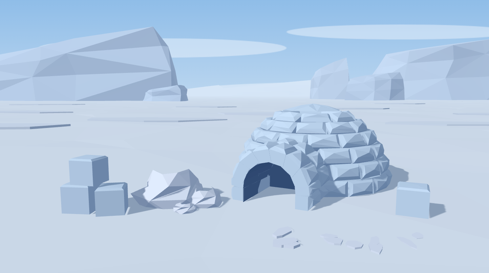

# 이글루 로비 씬 생성기 (Unity)

참고 이미지(하늘색 로우폴리 빙하 + 블록으로 쌓은 이글루) 분위기의 **로비 화면을 자동으로 만들어 주는** Unity 에디터 도구입니다.

> 위 이미지는 같은 메시 생성 코드를 웹(three.js)에서 렌더링한 미리보기입니다. Unity에서는 조명과 셰이더 차이로 색감이 조금 다를 수 있습니다.

## 설치

1. 이 폴더의 `Assets/IglooLobby` 폴더를 통째로 `D:\Unity\Projects\igloo\Assets\` 아래에 복사합니다.
2. Unity를 열면 자동으로 컴파일됩니다. (Built-in, URP 둘 다 지원)

## 로비 씬 만들기

1. 메뉴에서 **Tools > Igloo > Lobby Builder**를 엽니다.
2. 모델 슬롯을 채웁니다. 비워둔 슬롯은 코드로 만든 로우폴리 모델이 대신 들어갑니다.
   - 캐릭터: 캐릭터 프리팹 또는 FBX
   - 이글루: 이글루 모델 (비우면 블록 이글루가 자동으로 만들어짐)
   - 빙하: 빙하 모델 (빙하 자리 5곳에 크기를 달리해 배치)
   - 망치 1~4: 각각 분리된 망치 프리팹
3. **로비 씬 생성**을 누르면 `Assets/IglooLobby/Lobby.unity`가 만들어지고 저장됩니다.

모델 크기가 맞지 않으면 각 슬롯 아래의 "크기" 값으로 조절한 뒤 다시 생성하세요.
위치를 바꾸고 싶다면 `Scripts/LobbyLayout.cs`의 숫자(카메라, 이글루, 캐릭터, 빙하 위치)를 고치고 다시 생성하면 됩니다.

## 망치 4개가 한 파일에 붙어 있을 때

1. Project 창에서 망치 모델 파일을 선택합니다.
2. **Tools > Igloo > Split Selected Model Into Prefabs**를 실행합니다.
3. 모델과 같은 폴더의 `<모델이름>_Split` 폴더에 `<모델이름>_1`부터 `<모델이름>_4`까지 프리팹이 왼쪽부터 순서대로 생깁니다.
   - 기준점은 각 망치의 맨 아래 가운데(손잡이 끝)로 맞춰집니다.
   - 머리와 손잡이처럼 맞닿아 있는 조각은 하나로 묶입니다.
4. 이렇게 만든 프리팹을 Lobby Builder의 망치 1~4 슬롯에 넣으면 됩니다.

## 들어 있는 것

| 파일 | 역할 |
|---|---|
| `Editor/IglooLobbyBuilder.cs` | 로비 씬 생성 창: 하늘, 안개, 조명, 카메라, 환경, 캐릭터 배치 |
| `Editor/ModelSplitter.cs` | 한 파일에 붙어 있는 모델을 여러 프리팹으로 분리 |
| `Scripts/LowPoly.cs` | 로우폴리 메시 생성(이글루 블록, 빙하, 유빙, 눈 더미, 얼음 큐브, 지면) |
| `Scripts/LobbyLayout.cs` | 배치 값과 씬 구성 |
| `Scripts/HammerSelector.cs` | 캐릭터 손에 망치를 들려주고 교체(이전/다음). 선택값은 저장됨 |
| `Scripts/LobbyUI.cs` | 테스트용 로비 UI(타이틀, 망치 선택 화살표, START) |
| `Scripts/LobbyCameraDrift.cs` | 카메라를 천천히 흔들어 화면에 생동감을 줌 |

## 망치 손 위치 맞추기

`HammerSelector`는 휴머노이드 리그의 오른손 본을 자동으로 찾습니다. 리그가 휴머노이드가 아니면 이름에 `hand`가 들어간 본을 찾습니다.
망치가 손에 어긋나 보이면 다음 순서로 맞추세요.

1. 플레이 모드에서 캐릭터의 `HammerSelector`에 있는 Grip Position / Rotation / Scale 값을 조절합니다(바로 반영됩니다).
2. 맞춘 값을 컴포넌트 메뉴의 Copy Component로 복사합니다.
3. 플레이를 끈 뒤 Paste Component Values로 붙여 넣습니다.

START 버튼으로 넘어갈 게임 씬은 `Lobby` 오브젝트의 `LobbyUI > Game Scene Name`에 입력합니다.
